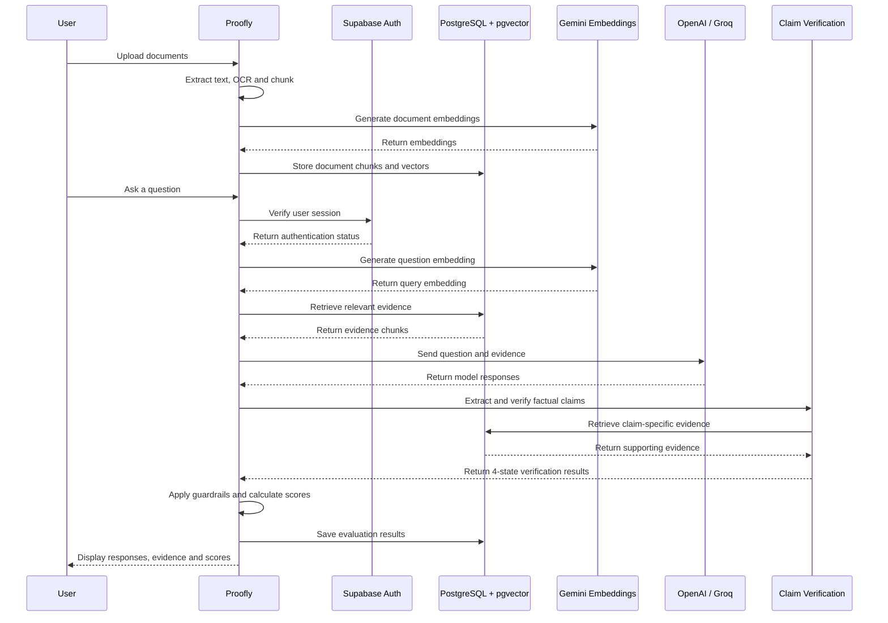

# Proofly
Proofly is an evidence-grounded AI evaluation platform and document fact-checking engine.It allows users to upload business documents, ask natural-language questions, compare responses from multiple AI models, extract individual factual claims, and verify each claim against retrieved document evidence.

## Features
- **Multi-Format Document Ingestion:** Supports PDF, Word, Excel, CSV, plain text, Markdown, and JSON, with Gemini Vision OCR for scanned documents and images.
- **Semantic Vector Storage (`pgvector`):** Generates 768-dimensional embeddings using Google Gemini and stores document chunks in PostgreSQL for semantic evidence retrieval. Uses HNSW indexing and cosine similarity search.
- **Concurrent Multi-Model Evaluation:** Runs evaluations concurrently using OpenAI and Groq, allowing users to compare responses from multiple AI models.
- **4-State Claim Verification Pipeline:** Extracts individual factual claims from AI responses, retrieves relevant document evidence, and classifies claims as `SUPPORTED`, `CONTRADICTED`, `UNSUPPORTED`, or `UNCERTAIN`.
- **Automated Guardrails:** Checks for policy violations, unsupported financial claims, and sensitive data leakage to identify potentially unsafe or ungrounded responses.
- **Evidence-Based Scoring:** Calculates two core evaluation metrics:
  - **Accuracy:** Percentage of factual claims supported by evidence (`supported / total`).
  - **Grounding:** Percentage of claims addressed by the documents (`(supported + contradicted) / total`).
- **Progressive Authentication & Guest Work Transfer:** Allows anonymous users to explore Proofly and transfers their documents and evaluations to their permanent account when they sign up or log in.

## System Architecture


## Requirements
- Node.js 
- Next.js 16
- PostgreSQL with the `pgvector` extension enabled (e.g. Supabase)
- Supabase project for authentication
- AI provider API keys (Groq and Google Gemini)

## Installation
- Clone the repository.
  ```bash
  git clone https://github.com/Udehlee/proofly.git
    cd proofly
    pnpm install
    pnpm run prisma:generate
    pnpm run prisma:deploy
    pnpm run dev
### Environment Configuration

Copy and configure  the example environment file:
```bash
cp .env.example
```

Open [http://localhost:3000](http://localhost:3000) in your browser.
